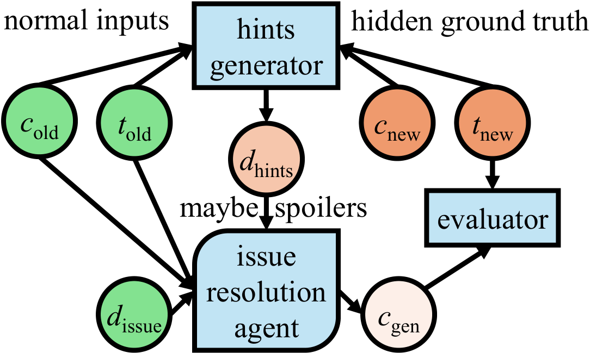
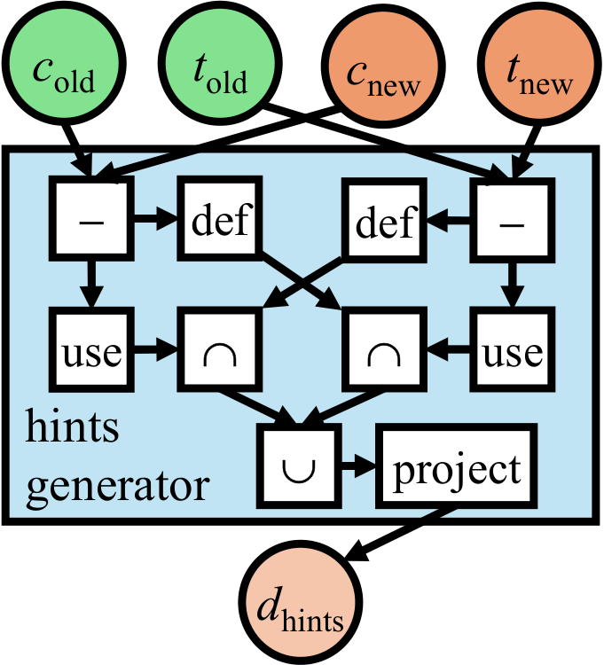

# Between Spoilers and Guesswork: Avoiding Over-Specification in Coding Benchmarks

This is the official repository for the paper "Between Spoilers and Guesswork: Avoiding
Over-Specification in Coding Benchmarks."

## Introduction

Repository-level coding benchmarks such as SWE-bench Pro, FEA-Bench, Doc2Feat-bench and
Multi-SWE-bench add **hints** to their task statements: identifiers taken from the reference
solution, so that an agent is not failed only for choosing a different name than the hidden
tests expect. Hints derived from the ground truth can also give part of the solution away.
This repository builds hints at controlled levels of detail, along two axes:

- **Selection**: which identifiers a hint reveals. Our policy, **DefUse**, keeps only the
  names through which the solution and its tests communicate.
- **Projection**: how much a hint reveals about each identifier. Our recommended projection,
  **Declaration**, gives what a declaration line states (name, kind, file, whether the file
  is new, signature) and no description of how the solution works.

<div align="center">

<details>
  <summary>Abstract</summary>
  <p align="left">
  Benchmarks drive AI progress, but are hampered by task under-specification and
  over-specification. Task under-specification causes guesswork, where solutions have to
  make things up, or worse, resort to contamination or reward hacking. Task
  over-specification causes spoilers, where solutions can bypass some of the harder steps
  the benchmark was supposed to measure. Since future-looking benchmarks should be
  difficult, over-specification reduces a benchmark's shelflife of community adoption.
  Repository-level coding benchmarks have helped the field progress but experience
  unnecessary churn due to both over- and under-specification. For instance, SWE-bench
  Pro, FEA-bench, Doc2Feat-bench, and Multi-SWE-bench all tackle under-specification by
  augmenting task statements with hints derived from ground truth. We show that leaking
  ground-truth information into the task statement causes over-specification in some of
  these benchmarks. We experiment with various specification levels, trying to thread the
  needle between spoilers and guesswork. Based on these results, we recommend techniques
  for deriving parsimonious hints. We will release our hints so the community can obtain
  more reliable signals from popular benchmarks.
  </p>
</details>



<em>To hint (perchance spoilers) or not to hint (guesswork): that is the question for
repository-level coding benchmarks.</em>

</div>

## Repository layout

| folder | what it contains | guide |
|---|---|---|
| `src/` | the hint pipeline: which names each patch reads and writes (step 1), the DefUse selection with every identifier's attributes (step 2), LLM-written descriptions (step 3); `src/lang/` adds Java | [src/README.md](src/README.md) |
| `repos/` | scripts that clone the benchmarks' repositories | [repos/README.md](repos/README.md) |
| `identity_selection/` | DefUse and the three baseline selection policies (Doc2Feat, FEA-Bench, SWE-bench Pro), each with a Java version | [identity_selection/README.md](identity_selection/README.md) |
| `identity_projection/` | the projections, and the generators of mini-SWE-agent instances | [identity_projection/README.md](identity_projection/README.md) |
| `mini-swe-agent/` | an overlay for [mini-SWE-agent](https://github.com/SWE-agent/mini-swe-agent): benchmark configs with a slot for the hints, runners, an optional Daytona backend | [mini-swe-agent/README.md](mini-swe-agent/README.md) |
| `helper_code/` | data preparation (`data_prepare/`, `fea_bench_data/`) and the LLM judge of hint attributes (`judge/`) | [helper_code/judge/README.md](helper_code/judge/README.md) |
| `hints_to_release/` | the paper's hints, ready to run | [hints_to_release/README.md](hints_to_release/README.md) |

## Setup

```bash
git clone git@github.com:IBM/swe-hints.git && cd swe-hints
python3.12 -m venv .venv && source .venv/bin/activate
pip install -r requirements.txt     # or requirements-lock.txt: the exact versions we tested
```

The `tree-sitter==0.21.3` pin in `requirements.txt` is required: a newer version makes the
parser fail with `TypeError: __init__() takes exactly 1 argument`. The stack is tested on
Python 3.12. All commands run from the repository root. mini-SWE-agent has its own
environment; see [mini-swe-agent/README.md](mini-swe-agent/README.md).

## DefUse

DefUse selects the identifiers that cross the boundary between a task's reference patch and
its tests. It is the union of two directions:

- **forward**: names the code patch defines and the tests use (`code_write ∩ test_read`),
  such as a new function the hidden test calls;
- **backward**: names the tests define and the code uses (`code_read ∩ test_write`), such
  as a fixture.

```text
DefUse = forward ∪ backward = (code_write ∩ test_read) ∪ (code_read ∩ test_write)
```

New Python files the code patch creates are always added. Names the issue text already
mentions are then dropped. What remains are the identifiers the hidden tests depend on and
the agent cannot read from the task; everything else the patch touches is left out.

<div align="center">



<em>DefUse hints generation pipeline.</em>

</div>

In the code, DefUse is the `communication` operator of the `src/` pipeline
([src/README.md](src/README.md)). `identity_selection/defuse2.py` is a standalone
implementation that also selects error messages the tests assert on
([identity_selection/README.md](identity_selection/README.md)).

## Quick start: DefUse hints for your own benchmark

**What you need.**

| you need | what it is for | details |
|---|---|---|
| one JSON line per task: `instance_id`, `repo`, `base_commit`, `patch`, `test_patch`, `problem_statement` | selecting the hints | [src/README.md](src/README.md#1-prepare-the-data) |
| read access to each task's Git repository, with full history | DefUse checks out `base_commit` and applies the patches | [repos/README.md](repos/README.md) |
| one container image per task, with the repository at `base_commit` and its dependencies installed | running the agent | [mini-swe-agent/README.md](mini-swe-agent/README.md#2-pick-the-benchmark-template) |
| a way to run each task's tests, such as lists of tests that must pass | scoring the agent's patches | [mini-swe-agent/README.md](mini-swe-agent/README.md#5-evaluate) |
| an LLM endpoint for the agent | running the agent | [mini-swe-agent/README.md](mini-swe-agent/README.md#3-write-a-model-config) |

Hint selection needs only the first two rows. Most of the work for a new benchmark is the
input file and the container images; nothing in this repository is benchmark-specific
beyond them.

Set these once; the commands in this repository's guides use them:

```bash
BENCH=mybench                   # short name, used for output folders
INPUT=data/mybench.jsonl        # the benchmark, one JSON object per line
REPOS=repos/${BENCH}_repos      # where the benchmark's repositories are cloned
OUT=results/${BENCH}_defuse     # outputs
mkdir -p data $OUT
```

**The whole path.** Each step names the guide that explains it.

```bash
# --- in this repository ---------------------------------------------------------
python repos/build_swerebench_repos.py --input $INPUT --repos-dir $REPOS      # repos/README.md

python -m src.identifier_usage --input $INPUT --repos-dir $REPOS \
    --output $OUT/extracted_hints.jsonl --skip-errors                           # src/README.md, step 1
python -m src.identifier_information --usage $OUT/extracted_hints.jsonl \
    --operator communication --level All \
    --output $OUT/hints_defuse.jsonl --skip-errors                              # src/README.md, step 2
python helper_code/filter_nonempty_identifiers.py \
    --input $OUT/hints_defuse.jsonl --output $OUT/hints_defuse_nonempty.jsonl   # src/README.md, step 2

P=declaration                                                                   # identity_projection/README.md
python identity_projection/project_enriched.py \
    -i $OUT/hints_defuse_nonempty.jsonl -o $OUT/${BENCH}_${P}_proj.jsonl -p $P
python identity_projection/generate_instances.py -H $OUT/${BENCH}_${P}_proj.jsonl \
    -s $INPUT -b swerebench -p $P -o results/miniswe_${BENCH}/${BENCH}_${P}.jsonl
python -c "import json,sys; [print(json.dumps({**json.loads(l), 'hints': ''})) for l in open(sys.argv[1])]" \
    results/miniswe_${BENCH}/${BENCH}_${P}.jsonl > results/miniswe_${BENCH}/${BENCH}_empty.jsonl

# --- in your mini-swe-agent checkout, with this repository's overlay -------------
HINTS=/path/to/swe-hints            # this repository; BENCH and P as above
REPO_DIR=/testbed                   # where your images keep the repository
sed "s#/testbed#${REPO_DIR}#g" src/minisweagent/config/benchmarks/swerebench_hints.yaml > mybench_hints.yaml

for V in $P empty; do                                                           # mini-swe-agent/README.md
  mini-extra swebench -c mybench_hints.yaml -c my_model.yaml \
      --subset $HINTS/results/miniswe_${BENCH}/${BENCH}_${V}.jsonl \
      --workers 8 --output ./output/${BENCH}_${V}
done
# then score ./output/${BENCH}_${V}/preds.json with your benchmark's tests
```

The result is one agent run with Declaration hints and one without hints, on the same
tasks. The difference in resolve rate between the two is what the hints are worth.

## Where to go next

| you want to | read |
|---|---|
| check and run DefUse hints with an agent | [hints_to_release/README.md](hints_to_release/README.md), then [mini-swe-agent/README.md](mini-swe-agent/README.md) |
| prepare a benchmark, including the four the paper uses, and run the pipeline step by step | [src/README.md](src/README.md) and [repos/README.md](repos/README.md) |
| compare selection policies (DefUse, Doc2Feat, FEA-Bench, SWE-bench Pro) under one projection | [identity_selection/README.md](identity_selection/README.md) |
| compare projections (Name Only, Doc2Feat, Declaration, Declaration+Doc, Pro) under DefUse | [identity_projection/README.md](identity_projection/README.md) |
| run the agent locally or in Daytona, and score it | [mini-swe-agent/README.md](mini-swe-agent/README.md) |
| score hint attributes for necessity, disclosure and guidance with an LLM judge | [helper_code/judge/README.md](helper_code/judge/README.md) |
| work with Java (Multi-SWE-bench) | the Java sections of [src/README.md](src/README.md#java-multi-swe-bench), [identity_selection/README.md](identity_selection/README.md#java) and [identity_projection/README.md](identity_projection/README.md#java-multi-swe-bench) |

## Contributing

Pull requests are very welcome! Make sure your patches are well tested.
Ideally create a topic branch for every separate change you make. For
example:

1. Fork the repo
2. Create your feature branch (`git checkout -b my-new-feature`)
3. Commit your changes (`git commit -am 'Added some feature'`)
4. Push to the branch (`git push origin my-new-feature`)
5. Create new Pull Request

## License

All source files must include a Copyright and License header. The SPDX license header is
preferred because it can be easily scanned.

If you would like to see the detailed LICENSE click [here](LICENSE).

```text
#
# Copyright IBM Corp. 2026
# SPDX-License-Identifier: MIT
#
```
